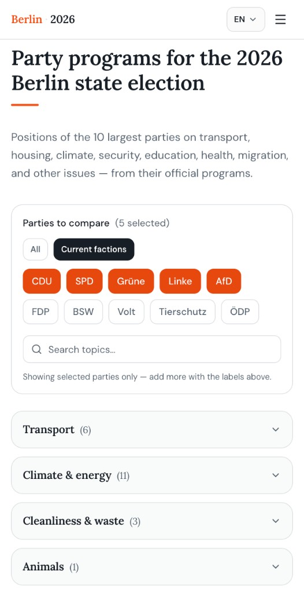
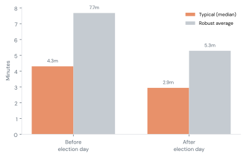
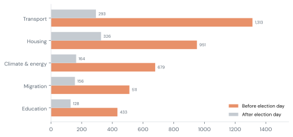
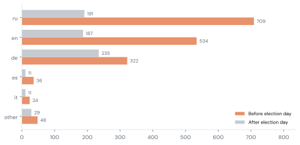
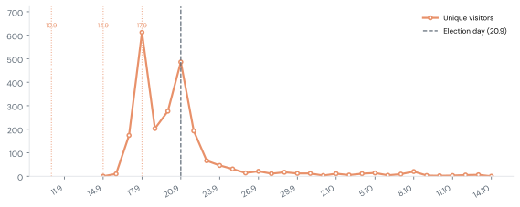

<link rel="stylesheet" href="./public-project-story.css" />

Wahlkompass·Berlin 202615.10.2026

# Helping Berliners make a more informed choice

An independent, multilingual comparison of party programs for Berlin’s state election on <strong>20 September 2026</strong>.

## Why this existed

Official party programs are published **only in German**, often ~**200 pages** — a barrier for internationals and anyone who wants to compare substance without reading every PDF.

Existing tools help with preference quizzes. We wanted something different: **positions side by side**, by topic, with a path back to the original programs — in languages people in Berlin actually use.

**Wahlkompass - Berlin 2026** is not a Wahl-O-Mat. It is not campaign material. It is an independent information project: **10 parties × 65 topics × 11 languages**. Summaries were drafted with AI help; people on the project stay editorially responsible ([AI disclosure](https://www.berlin-2026.de/en/ai-disclosure)).

## What we offered

A free comparison table where you can:

- Open topics that matter to you (transport, housing, climate, migration, and more)
- Choose which parties to compare
- Read short, comparable positions drawn from official programs
- Follow citations and program links when you want to verify

<figure class="product-shot">
  
  <figcaption>The comparison on berlin-2026.de — pick parties, search topics, read positions side by side.</figcaption>
</figure>

## Impact: who we helped

About 4,300 people reached the comparison

Thousands of people had a chance to compare party programs in a language they could use — before (and after) they voted.

~4&nbsp;min typical visit · ~64% mobile · 11 languages · peak week ~2,700 visitors

<figure class="chart">
  
  <figcaption>Before vs after election day (typical &amp; robust average).</figcaption>
</figure>

### They did compare — not just glance

Among people who used the comparison in the final stretch before polls closed, a **typical visit lasted about 4 minutes**. Around **7 in 10** stayed longer than two minutes. That depth is how we know the tool helped with **informed looking**: people stayed long enough to read positions, not bounce after a screenshot. Hundreds also followed links back to original program text to verify.

<figure class="chart">
  
  <figcaption>Top topic groups before vs after election day.</figcaption>
</figure>

### What people cared about

Transport and housing led interest — A100, U-Bahn, rent and social housing, Tempelhofer Feld — with migration and climate close behind.

<figure class="chart">
  
  <figcaption>Top languages before vs after election day.</figcaption>
</figure>

### Languages reflect where outreach landed

English, Russian, and German were strongest (lifetime homes roughly **1.8k / 1.6k / 1.0k** visitors). That mix is not only “who exists in Berlin”; it largely shows **where we managed to reach communities**.

<figure class="chart">
  
  <figcaption>Daily visitors; dotted marks = key publication days; dashed = election day.</figcaption>
</figure>

### How people found us

Nine community publications shared the project in the ten days before the election. Peaks lined up with those shares (especially mid-September) and election day. Among them:

-  [Volna / Berlin](https://t.me/berlinwelle/2782) (Telegram)
-  [Handpicked Berlin](https://newsletter.handpickedberlin.com/p/211-who-you-gon-call-vote-for) (Newsletter)
-  [20 Percent Berlin](https://www.20percent.berlin/p/528-election-fever-berliners-pro) (Substack)
-  [The Berlin Life](https://theberlinlife.substack.com/p/berlin-election-2026-who-can-vote) (Substack)
-  [Goose Expat](https://t.me/goose_expat/2098) (Telegram)

We also reached out to NGOs and organisations that work with local communities in the languages we covered. We cannot tell whether that outreach brought visits — those contacts were not measured in a way that lets us attribute traffic.

We had **no advertising budget**. Growth was earned goodwill and search — mostly direct visits, Google, and Substack/Telegram.

### A pleasant surprise after the vote

We expected interest to stop when polls closed. It did not. People kept coming through mid-October. Comparing programs still mattered to some Berliners even when the ballot was over. That afterlife was an unexpected gift of the project.

## What held us back

We are proud of what shipped on almost no money. We are also clear about the limits of a two-person volunteer project:

- **Translations without community polish** — We could not involve language communities enough to review and refine wording. Nuance suffered where we lacked reviewers.
- **Outreach capacity** — We did not have enough time to reach every community we hoped to. Language visits largely mirror **where outreach succeeded**, not the full map of demand.
- **Late detail tracking** — Richer tracking of which topics people opened arrived only about a week before the election, so the deepest “what people compared” picture covers the final stretch.
- **Almost no cash** — There was no funding. Our total cash outlay was about **€25**, split between the two of us. Everything else was volunteer time.

## Contact us

Questions about the project, corrections, partnerships, or translations? We would love to hear from you.

**Email:** [feedback@berlin-2026.de](mailto:feedback@berlin-2026.de)  
**Site:** [www.berlin-2026.de](https://www.berlin-2026.de)  
**About & AI disclosure:** [About](https://www.berlin-2026.de/en/about) · [AI disclosure](https://www.berlin-2026.de/en/ai-disclosure)

Sister civic work: [Water for All](https://www.water4all.com.de) — an open atlas of free drinking water in Berlin.

<em>About the numbers:</em> Reach figures are from privacy-respecting site analytics from when visitors first arrived (early September) through mid-October 2026. Engagement depth uses the instrumented window from mid-September. Topic opens are incomplete (tracking started late). We round for readability.

