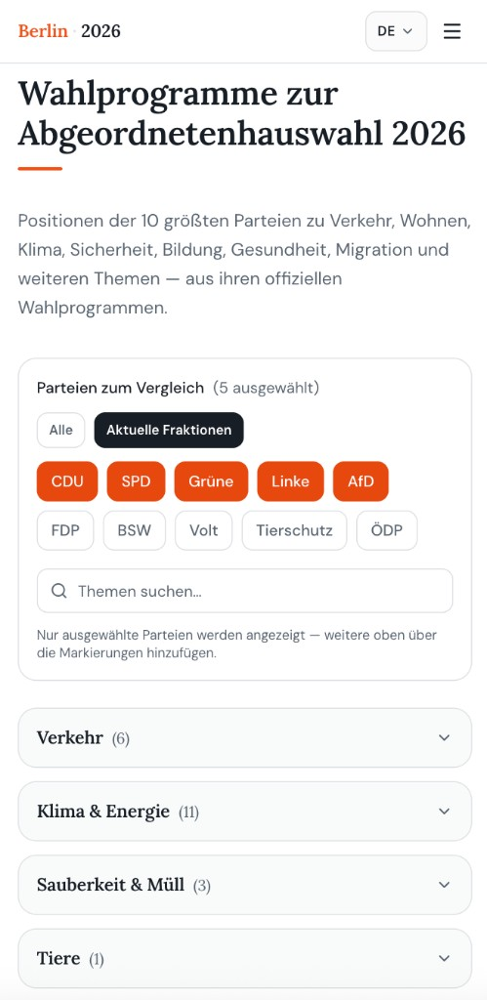
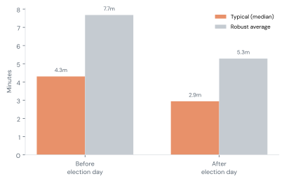
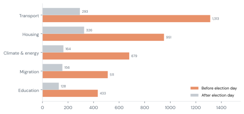
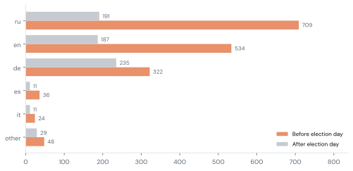
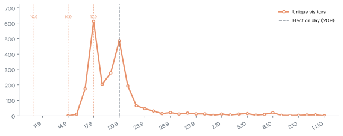

<link rel="stylesheet" href="./public-project-story.css" />

Wahlkompass·Berlin 202615.10.2026

# Damit Berliner:innen fundierter wählen können

Ein unabhängiger, mehrsprachiger Vergleich der Wahlprogramme zur Abgeordnetenhauswahl in Berlin am <strong>20. September 2026</strong>.

## Warum es uns gab

Offizielle Wahlprogramme erscheinen **nur auf Deutsch** und sind oft rund **200 Seiten** lang — eine Hürde für internationale Berliner:innen und für alle, die Inhalte vergleichen wollen, ohne jedes PDF durchzuarbeiten.

Es gibt schon Hilfen wie den Wahl-O-Mat. Wir wollten etwas anderes: **Positionen nebeneinander**, nach Thema, mit dem Weg zurück zu den Originalprogrammen — in Sprachen, die in Berlin gesprochen werden.

**Wahlkompass - Berlin 2026** ist kein Wahl-O-Mat und kein Wahlkampfmaterial. Es ist ein unabhängiges Informationsprojekt: **10 Parteien × 65 Themen × 11 Sprachen**. Zusammenfassungen entstanden mit KI-Hilfe; die redaktionelle Verantwortung liegt beim Projekt ([KI-Hinweis](https://www.berlin-2026.de/de/ai-disclosure)).

## Was wir angeboten haben

Eine kostenlose Vergleichstabelle, in der man:

- Themen öffnen kann, die einen interessieren (Verkehr, Wohnen, Klima, Migration und mehr)
- auswählen kann, welche Parteien verglichen werden
- kurze, vergleichbare Positionen aus den offiziellen Programmen lesen kann
- Zitate und Programmlinks folgen kann, um nachzuprüfen

<figure class="product-shot">
  
  <figcaption>berlin-2026.de — Parteien wählen, Themen suchen, Positionen vergleichen.</figcaption>
</figure>

## Wirkung: wem wir geholfen haben

Etwa 4.300 Menschen haben den Vergleich genutzt

Tausende konnten Parteiprogramme in einer Sprache vergleichen, die sie beherrschen — vor der Wahl und danach.

~4&nbsp;Min. typischer Besuch · ~64&nbsp;% mobil · 11 Sprachen · stärkste Woche ~2.700 Besuchende

<figure class="chart">
  
  <figcaption>Vor vs. nach dem Wahltag (typisch &amp; robustes Mittel).</figcaption>
</figure>

### Wirklich verglichen — nicht nur kurz reingeschaut

Wer den Vergleich in den letzten Tagen vor der Schließung der Wahllokale genutzt hat, blieb typischerweise **etwa 4 Minuten**. Rund **7 von 10** blieben länger als zwei Minuten. Das zeigt uns: Viele haben **wirklich hingeschaut** — lange genug, um Positionen zu lesen, statt nach einem Screenshot wieder zu gehen. Hunderte folgten außerdem Links zurück zum Originaltext im Programm.

<figure class="chart">
  
  <figcaption>Top-Themengruppen vor vs. nach dem Wahltag.</figcaption>
</figure>

### Was die Leute interessiert hat

Am stärksten nachgefragt waren Verkehr und Wohnen — A100, U-Bahn, Miete und sozialer Wohnungsbau, Tempelhofer Feld — dicht gefolgt von Migration und Klima.

<figure class="chart">
  
  <figcaption>Top-Sprachen vor vs. nach dem Wahltag.</figcaption>
</figure>

### Sprachen zeigen, wo unsere Ansprache wirkte

Am stärksten genutzt wurden Englisch, Russisch und Deutsch (Lebenszeit-Homes grob **1,8k / 1,6k / 1,0k** Besuchende). Diese Mischung sagt nicht nur, wer in Berlin lebt; sie zeigt vor allem, **wo wir Communities erreichen konnten**.

<figure class="chart">
  
  <figcaption>Tägliche Besuchende; Punkte = wichtige Publikationstage; gestrichelt = Wahltag.</figcaption>
</figure>

### Wie die Leute uns gefunden haben

Neun Community-Publikationen haben das Projekt in den zehn Tagen vor der Wahl geteilt. Die Besuchsspitzen lagen bei diesen Erwähnungen (besonders Mitte September) und am Wahltag. Darunter:

- [Volna / Berlin](https://t.me/berlinwelle/2782) (Telegram)
- [Handpicked Berlin](https://newsletter.handpickedberlin.com/p/211-who-you-gon-call-vote-for)
- [20 Percent Berlin](https://www.20percent.berlin/p/528-election-fever-berliners-pro)
- [The Berlin Life](https://theberlinlife.substack.com/p/berlin-election-2026-who-can-vote)
- [Goose Expat](https://t.me/goose_expat/2098) (Telegram)

Wir hatten **kein Werbebudget**. Wachstum kam über Weiterempfehlungen und Suche — vor allem Direktbesuche, Google sowie Substack/Telegram.

### Eine angenehme Überraschung nach der Wahl

Wir hatten erwartet, dass das Interesse mit der Schließung der Wahllokale endet. Das war nicht so. Bis Mitte Oktober kamen weiterhin Menschen. Programme zu vergleichen blieb für manche relevant, obwohl die Wahl vorbei war — ein unerwartetes Nachleben des Projekts.

## Was uns gebremst hat

Wir sind stolz auf das, was mit fast keinem Geld entstanden ist. Gleichzeitig kennen wir die Grenzen eines Zwei-Personen-Ehrenamtsprojekts:

- **Übersetzungen ohne Community-Feinschliff** — Wir konnten Sprachgemeinschaften nicht genug einbeziehen, um Formulierungen zu prüfen und zu schärfen. Wo niemand gegengelesen hat, fehlte oft die Nuance.
- **Zu wenig Zeit für Ansprache** — Wir haben nicht jede Community erreicht, die wir erreichen wollten. Die Sprachverteilung spiegelt weitgehend wider, **wo unsere Ansprache wirkte** — nicht die volle Nachfrage.
- **Späte Detailmessung** — Genaueres Tracking dazu, welche Themen geöffnet wurden, gab es erst etwa eine Woche vor der Wahl. Das detaillierteste Bild von „was verglichen wurde“ betrifft deshalb vor allem die Endphase.
- **Fast kein Geld** — Es gab keine Förderung. Unsere gesamten Ausgaben lagen bei etwa **25 €**, geteilt zu zweit. Alles andere war Ehrenamt.

## Kontakt

Fragen zum Projekt, Korrekturen, Partnerschaften oder Übersetzungen? Schreiben Sie uns gern.

**E-Mail:** [feedback@berlin-2026.de](mailto:feedback@berlin-2026.de)  
**Website:** [www.berlin-2026.de](https://www.berlin-2026.de)  
**Über uns & KI-Hinweis:** [Über uns](https://www.berlin-2026.de/de/about) · [KI-Hinweis](https://www.berlin-2026.de/de/ai-disclosure)

Schwesterprojekt: [Wasser für alle](https://www.water4all.com.de/de) — offener Atlas freier Trinkwasserstellen in Berlin.

<em>Zu den Zahlen:</em> Die Reichweite stammt aus datenschutzfreundlicher Website-Analyse vom Eintreffen der ersten Besuchenden (Anfang September) bis Mitte Oktober 2026. Angaben zur Nutzungstiefe beziehen sich auf den Zeitraum ab Mitte September, in dem detailliert gemessen wurde. Themenöffnungen sind unvollständig (die Messung begann spät). Zahlen sind zur Lesbarkeit gerundet.

